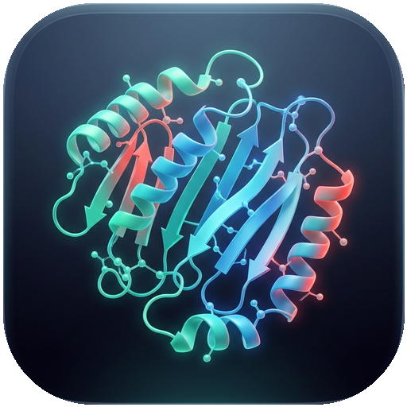
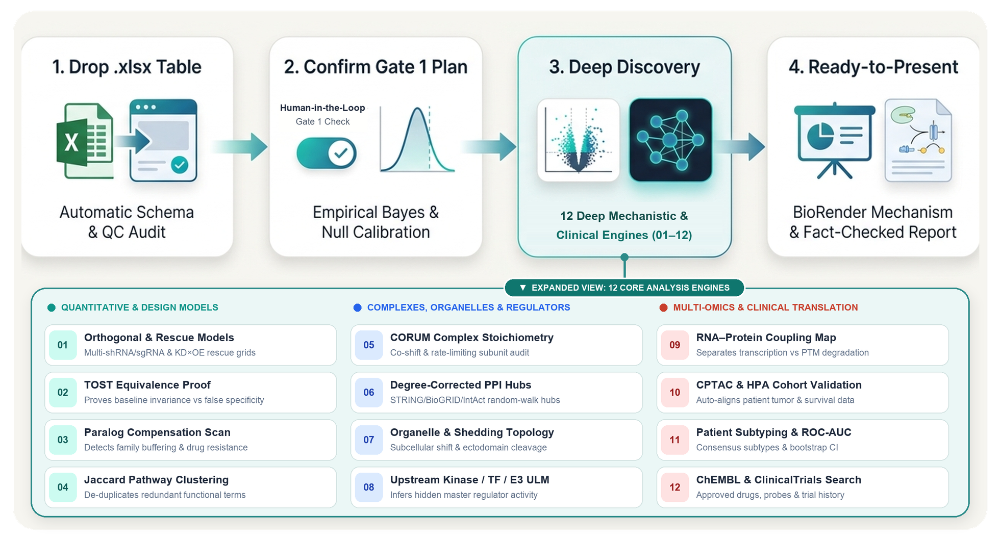
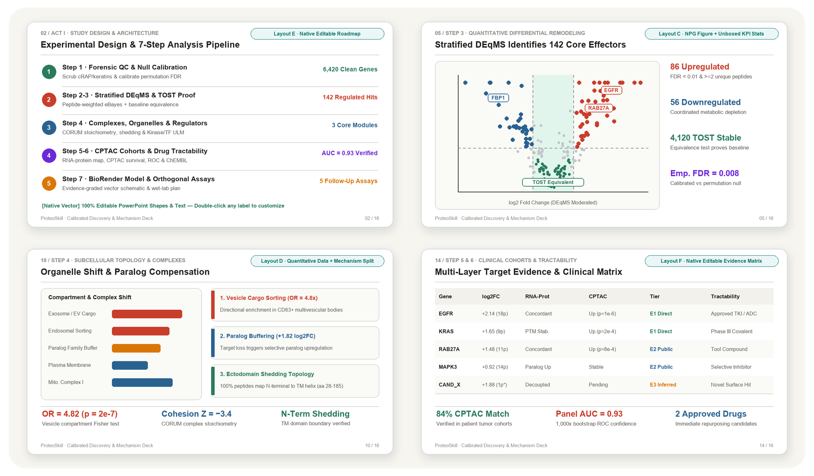
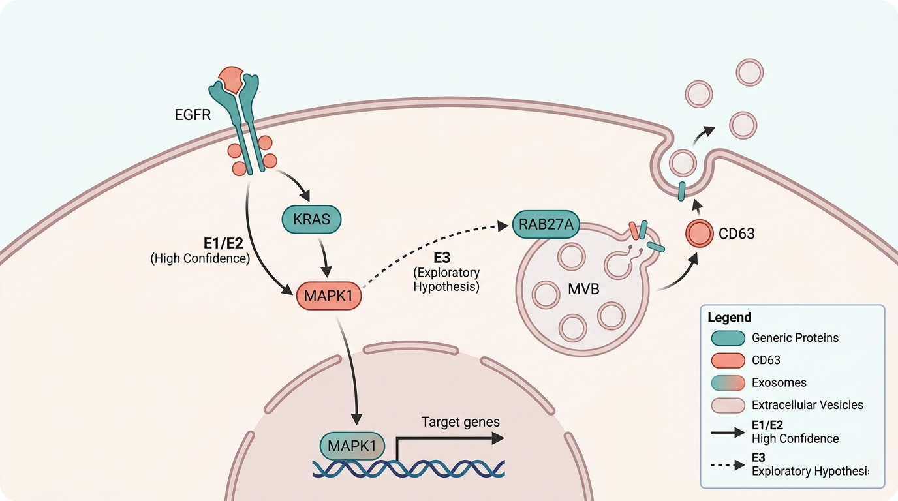

<div align="center">



# ProteoSkill

### End-to-End Statistical Calibration, Mechanistic Deconvolution, BioRender Schematics & Biologist-First Group-Meeting Slides for Mass-Spectrometry Proteomics

<p>
  <a href="#-at-a-glance">At a Glance</a> ·
  <a href="#-zero-code-quickstart-3-prompts">Quickstart</a> ·
  <a href="#-why-proteoskill-generic-ai-vs-proteoskill">Why ProteoSkill</a> ·
  <a href="#-architecture--the-12-discovery-engines">Pipeline & 12 Engines</a> ·
  <a href="#-visual-showcase">Visual Showcase</a> ·
  <a href="#-what-you-get-in-your-output-folder">Output Structure</a> ·
  <a href="#-supported-platforms--reference-playbooks">Reference Playbooks</a>
</p>

[](https://github.com/owehann/proteomics-discovery-skill/actions/workflows/ci.yml)
[](https://agentskills.io)
[](#-zero-code-quickstart-3-prompts)
[](#-architecture--the-12-discovery-engines)
[](./LICENSE)

</div>

<br/>

<div align="center">
  
</div>

<br/>

---

## ✨ At a Glance

**ProteoSkill** (`proteomics-discovery-skill`) is a self-contained AI Agent Skill built for **wet-lab biologists, translational clinicians, and bioinformaticians**. Drop your exported proteomics spreadsheet (`.xlsx`, `.tsv`, `.csv`, `.parquet`) into your workspace and talk to your AI assistant (**Claude Code**, **Antigravity**, **Cursor**, or **Codex**) in plain language.

<table width="100%">
  <tr>
    <td width="50%" valign="top">
      <h3>🔬 1. Forensic QC & Empirical Null Calibration</h3>
      <p>Automatically repairs Excel date-corrupted gene symbols (<code>1-Mar</code> → <code>MARCHF1</code>), strips <code>cRAP</code>/keratin/serum contaminants, audits subcellular/EV purity (<code>MISEV2023</code>), and computes exact shared-control empirical null FDRs to prevent 20× false-positive inflation in small-<i>N</i> screens.</p>
    </td>
    <td width="50%" valign="top">
      <h3>🧬 2. 12 Deep Mechanistic & Clinical Engines</h3>
      <p>Goes far beyond a basic volcano plot: resolves Dual-Track <code>DEqMS + &lt;LOD</code> binary switches, reciprocal <code>KD × OE</code> rescues, 9-sector epistasis with <code>TOST</code> equivalence proof, <code>UniProt</code> membrane topology, <code>CORUM</code> complex stoichiometry, degree-binned <code>STRING KDA</code> hubs, and 5-Layer <code>RRA</code> target prioritization.</p>
    </td>
  </tr>
  <tr>
    <td width="50%" valign="top">
      <h3>🎨 3. 14 NPG Figures & 7 BioRender Schematics</h3>
      <p>Programmatically renders 20+ unique 300-DPI PNG + vector PDF statistical figures (with force-repelled non-overlapping gene labels) plus <strong>7 modular BioRender-style vector schematics</strong> (<code>.svg</code> &amp; <code>300-DPI .png</code>) where validated findings (<code>E1/E2</code>) use solid arrows and exploratory hypotheses (<code>E3</code>) use dashed arrows.</p>
    </td>
    <td width="50%" valign="top">
      <h3>📊 4. Biologist-First 20–28 Slide PPTX & Fact Gate</h3>
      <p>Builds native-editable 16:9 presentations across 6 editorial layouts with plain-language reading guides, a dedicated <strong>Penultimate Literature &amp; Core Genes Summary Slide (<code>s26</code>)</strong>, bilingual speaker notes, and a 9-point machine-checked Fact &amp; Citation Gate (<code>0</code> hallucinated numbers or PMIDs).</p>
    </td>
  </tr>
</table>

<br/>

---

## 🚀 Zero-Code Quickstart (3 Prompts)

You do **not** need to write R or Python code. Copy and paste these 3 prompts into your AI coding assistant:

### Step 1 · One-Time Installation
> **"Please install ProteoSkill from `https://github.com/owehann/proteomics-discovery-skill` into my global skills directory and set up its Python/R dependencies for me."**

### Step 2 · Drop Your `.xlsx` File & Review the Gate 1 Plan
> **"I placed my proteomics data in `results.xlsx`. Please use ProteoSkill to inspect the sample groups, check data quality, and show me the Gate 1 analysis plan before running."**

### Step 3 · Confirm & Run the Full Discovery Pipeline
> **"The sample grouping looks right. Please run the full ProteoSkill workflow, execute all 12 mechanistic and clinical engines, generate the 14 NPG figures and 7 BioRender schematics, and build a biologist-friendly group-meeting PowerPoint with bilingual notes."**

<br/>

> [!TIP]
> **Smart Interactive Checkpoints (Gates 1–3)**
> - **Gate 1 (Always pauses)**: Confirms your inferred sample groups, contrasts, and experimental modality before running statistical models.
> - **Gate 2 (Conditional)**: Pauses *only* if an abnormal outlier tube (`>20%` ID drop or contaminant spike) or an unquantified bait protein is detected.
> - **Gate 3 (Conditional)**: Pauses *only* if a restricted clinical cohort requires manual login to access.

<details>
<summary><strong>📋 Click to Expand: Copy-Paste Prompt Templates by Experimental Modality</strong></summary>

<br/>

- **Genetic Perturbation (`KD / KO / OE / Multi-Clone Rescue`)**:
  > *"Use ProteoSkill on `kd_oe_proteome.xlsx`. Compare our knockdown and overexpression arms against control, run Dual-Track DEqMS + `<LOD` binary switch analysis, TOST equivalence testing, and paralog compensation scanning, and build the BioRender schematics and group-meeting PPTX."*

- **Extracellular Vesicle (`EV`) / Exosome / Secretome**:
  > *"Use ProteoSkill on `ev_proteome.xlsx`. Audit MISEV2023 EV purity vs. serum/keratin contaminants, run UniProt membrane vs. soluble sorting topology analysis, bridge with clinical secretome cohorts, and generate the EV sorting model and slides."*

- **Post-Translational Modifications (`Phospho / Ubiquitin / Acetyl`)**:
  > *"Use ProteoSkill on `phospho_sites.tsv` and `whole_proteome.tsv`. Decouple PTM site stoichiometry from host protein abundance, infer upstream kinase/E3 ligase activities, and generate the signaling network and presentation."*

- **Thermal Stability (`TPP / CETSA / PISA`) or Dose-Response (`EC50 / IC50`)**:
  > *"Use ProteoSkill on `drug_tpp_curves.xlsx`. Fit NPARC melting shifts and CurveCurator dose-response curves, cross-check ChEMBL tractability and CORUM complex engagement, and generate the target engagement report and PPTX."*

</details>

<br/>

---

## 🛡️ Why ProteoSkill? (Generic AI vs. ProteoSkill)

Asking an unguided LLM to analyze a proteomics spreadsheet frequently produces statistical artifacts, overclaimed noise, and unreadable slides. **ProteoSkill** enforces strict biostatistical and visual engineering guardrails:

| Challenge | ❌ Unguided Generic AI Assistant | ✅ ProteoSkill Calibrated Pipeline |
| :--- | :--- | :--- |
| **Gene Symbols & Contaminants** | Leaves Excel date-corrupted genes (`1-Mar`, `2-Sep`) and keratin/serum spikes (`KRT1`, `ALB`) inside pathway enrichments. | **Stage 0–1 Forensic Sanitizer**: Restores HGNC symbols (`1-Mar` → `MARCHF1`), strips `cRAP`/keratin/trypsin artifacts, and quarantines `1-peptide` detections. |
| **Small-$N$ & Shared Controls** | Applies naive thresholds across $k$ clones sharing a single control tube, inflating false positives up to **29-fold**. | **Stage 1.5 Shared-Control Null Integral**: Models exact shared-control covariance ($r = 0.50$) and caps noisy arms at **Exploratory (`E3`)**. |
| **"Specificity" Claims** | Claims a target is "Perturbation-A Specific" simply because $p < 0.05$ in A and $p = 0.12$ in B (*absence-of-evidence fallacy*). | **Engine `[02]` Formal `TOST` Equivalence**: Requires both a significant divergence test and Two One-Sided Tests (`TOST`) proving invariance in B. |
| **Biological Depth** | Stops at a single volcano plot and redundant GO terms without explaining *how* complexes or compartments remodel. | **12 Deep Discovery Engines (`[01]`–`[12]`)**: Integrates `<LOD` switches, Seesaw flux, `UniProt` topology, `CORUM` complexes, `STRING KDA`, `CPTAC/DepMap`, and 5-Layer `RRA`. |
| **Group-Meeting Slides** | Generates cramped "bullet-wall" slides, repeats the same plot on multiple slides, or uses cryptic statistical jargon. | **Biologist-First 20–28 Slide Deck**: 6 alternating layouts, plain-language visual reading guides, **Penultimate Literature & Core Genes Slide (`s26`)**, and `0` duplicate images. |
| **Numeric & Citation Honesty** | Hallucinates plausible-sounding `PMID`s or misquotes fold-changes from memory. | **Stage 7 Pre-Delivery Fact Gate**: Cross-checks every gene-number pair against `facts.json` and verifies every `PMID/DOI` via live NCBI/EuropePMC APIs. |

<br/>

---

## 🧭 Architecture & The 12 Discovery Engines

### End-to-End 8-Stage Execution Flow

```mermaid
flowchart LR
    A["📂 Raw Input<br/>(.xlsx / .tsv / .parquet)"] --> B["🔍 Stage 0 & Gate 1<br/>Schema & Power Audit"]
    B --> C["🛡️ Stage 1 & 1.5<br/>12-Point QC & Null FDR"]
    C --> D["📐 Stage 2 & 3<br/>DEqMS, LOD Switches & TOST"]
    D --> E["🕸️ Stage 4<br/>Topology, CORUM & KDA"]
    E --> F["🏥 Stage 5<br/>CPTAC, DepMap & 5-Layer RRA"]
    F --> G["🎨 Stage 6<br/>14 NPG + 7 BioRender + PPTX"]
    G --> H["✅ Stage 7<br/>9-Point Fact & Citation Gate"]

    style A fill:#F8FAFC,stroke:#64748B,stroke-width:2px,color:#0F172A
    style B fill:#EFF6FF,stroke:#2563EB,stroke-width:2px,color:#1E3A8A
    style C fill:#FEF3C7,stroke:#D97706,stroke-width:2px,color:#78350F
    style D fill:#ECFDF5,stroke:#059669,stroke-width:2px,color:#064E3B
    style E fill:#F0FDF4,stroke:#0D9488,stroke-width:2px,color:#134E4A
    style F fill:#EEF2FF,stroke:#4F46E5,stroke-width:2px,color:#312E81
    style G fill:#FDF2F8,stroke:#DB2777,stroke-width:2px,color:#831843
    style H fill:#F0FDF4,stroke:#16A34A,stroke-width:2.5px,color:#14532D
```



<br/>

### The 12 Built-In Deep Discovery Engines (Organized into 3 Pillars)

<table width="100%">
  <tr>
    <td width="33%" valign="top">
      <h4>📐 Pillar I · Quantitative &amp; Epistatic Deconvolution</h4>
      <ul>
        <li><b>Engine <code>[01]</code> · Dual-Track &amp; Reciprocal Solver</b><br/>Combines continuous <code>DEqMS</code> moderated <i>t</i>-tests with Track B <code>&lt;LOD</code> binary switches, reciprocal <code>KD × OE</code> rescue grids (<code>R-Score</code>), and Seesaw (<code>S7/G7</code>) antagonistic flux.</li>
        <br/>
        <li><b>Engine <code>[02]</code> · Two One-Sided Equivalence (<code>TOST</code>)</b><br/>Statistically certifies unperturbed baseline sectors within <code>±Δ<sub>eq</sub></code> to separate true pathway specificity from low statistical power.</li>
        <br/>
        <li><b>Engine <code>[03]</code> · Paralog Compensation Scanner</b><br/>Audits sequence-related paralogs and family members to detect compensatory buffering upon target knockdown or degradation.</li>
      </ul>
    </td>
    <td width="33%" valign="top">
      <h4>🕸️ Pillar II · Biophysical, Complex &amp; Network Topology</h4>
      <ul>
        <li><b>Engine <code>[04]</code> · Jaccard De-Redundant ORA</b><br/>Clusters overlapping <code>GO</code>, <code>Reactome</code>, and <code>Hallmark</code> sets against the empirically detected background proteome.</li>
        <br/>
        <li><b>Engine <code>[05]</code> · <code>CORUM</code> Complex Stoichiometry</b><br/>Tests coordinated co-shifts and subunit coherence across macromolecular machines (e.g., Proteasome, ESCRT, Replisome, OXPHOS).</li>
        <br/>
        <li><b>Engine <code>[06]</code> · Degree-Binned <code>STRING KDA</code></b><br/>Runs Random Walk with Restart (<code>RWR</code>) calibrated against 1,000 degree-matched permutations to pinpoint Lock-and-Key bridge hubs.</li>
        <br/>
        <li><b>Engine <code>[07]</code> · <code>UniProt</code> Membrane Topology</b><br/>Audits Signal Peptides, 1-TM receptors, 4-TM MARVEL/Tetraspanin scaffolds, GPI-anchors, and lipid-raft sorting via Fisher's exact tests.</li>
        <br/>
        <li><b>Engine <code>[08]</code> · Scoped Master Regulator <code>ULM</code></b><br/>Infers upstream transcription factors (<code>CollecTRI</code> on WCL/Tissue) or kinases (<code>Kinase Library</code> on PTM sites).</li>
      </ul>
    </td>
    <td width="34%" valign="top">
      <h4>🏥 Pillar III · Clinical Multi-Omics &amp; 5-Layer RRA</h4>
      <ul>
        <li><b>Engine <code>[09]</code> · RNA–Protein Coupling Map</b><br/>Separates transcriptional induction from post-translational stabilization, degradation, or vesicular export across paired cohorts.</li>
        <br/>
        <li><b>Engine <code>[10]</code> · <code>CPTAC</code>, Biofluid &amp; <code>DepMap</code> Bridge</b><br/>Aligns paired tumor-vs-normal proteomes, biofluid Secretion Gradient Indices (<code>SGI</code>), and <code>DepMap</code> CRISPR paracrine vs. cell-autonomous essentiality.</li>
        <br/>
        <li><b>Engine <code>[11]</code> · 3-Lens × 5-Layer <code>RRA</code> &amp; Bootstrap</b><br/>Integrates 5 orthogonal evidence layers via Kolde Beta-RRA with 1,000× Dirichlet weight stability to select the 36 Core &amp; Top-6 Flagship targets.</li>
        <br/>
        <li><b>Engine <code>[12]</code> · <code>ChEMBL</code> &amp; Clinical Trial Audit</b><br/>Queries approved drugs, chemical probes, and both positive and negative clinical trials alongside live PubMed/EuropePMC verification.</li>
      </ul>
    </td>
  </tr>
</table>

<br/>

---

## 🖼️ Visual Showcase

### 1. Biologist-First Editorial 16:9 PowerPoint Decks (20–28 Slides · 6 Native-Editable Layouts)

<div align="center">
  
</div>

<br/>

- **Plain-Language Visual Reading Guides**: Every slide's callouts and bilingual speaker notes explain **(1) Why this step was performed**, **(2) How to read the axes, colors, and highlights on the figure**, **(3) Which specific core genes & pathways changed and their biological meaning**, and **(4) How this finding motivates the next slide**.
- **Mandatory Penultimate Literature & Core Genes Cheat Sheet (`Slide N-1`)**: Directly before the final Wet-Lab Validation Roadmap, every comprehensive deck includes a dedicated synthesis slide (`s26_biorender_single_kd_summary.png`) summarizing each perturbation's **Top Upregulated & Downregulated Genes**, **Dysregulated Pathways**, **Landmark Literature (`Author et al., Year, PMID`)**, and **Biological Takeaway**.

<br/>

### 2. Evidence-Graded 7-Schematic BioRender Vector Suite (`.svg` & `300-DPI .png`)

<div align="center">
  
</div>

<br/>

- **7 Modular Vector Schematics per Study**: Generates `s01` (Hero Graphical Abstract), `s03` (Experimental Causal Locks), `s14` (Membrane & Subcellular Topology), `s17` (STRING KDA Lock-and-Key Subnetwork), `s24` (Top-6 Flagship Subcellular Cards), `s25` (Integrated Working Model), and `s26` (Penultimate Perturbation & Literature Cheat Sheet).
- **Strict Visual Evidence Grading**: Validated mass-spectrometry findings (`E1/E2`) are rendered with **solid causal arrows**, while exploratory hypotheses (`E3`) or single-peptide candidates (`[1-pep*]`) are automatically rendered with **dashed borders and dashed arrows**.

<br/>

---

## 📦 What You Get in Your Output Folder

After confirming Gate 1, ProteoSkill generates a clean, self-contained, and fully reproducible deliverable directory:

```text
your_project_folder/
├── design.yaml & analysis_spec.yaml                  # Pre-registered experimental design & statistical contract
├── Report_Calibrated_Discovery.md                    # Complete, fact-checked narrative research report
├── Group_Meeting_Presentation.pptx                   # 20–28 slide 16:9 biologist-first PowerPoint deck
├── Group_Meeting_Presentation_Notes_Bilingual.md     # Bilingual Chinese + English visual & biological reading guide
│
├── figures/                                          # Complete 14-Figure NPG Suite + 7 BioRender Vector Schematics
│   ├── s01_biorender_hero.svg (.png)                 # [BioRender 1] Cover Graphical Abstract
│   ├── s03_biorender_exp_design.svg (.png)           # [BioRender 2] Experimental Design & 3-Lock Causal Architecture
│   ├── s04_manual_cutoff_audit.png                   # [Plot 01] Naive fold-change cutoff audit vs calibrated pipeline
│   ├── s05_proteome_filtering_funnel.png             # [Plot 02] Multi-step sanitization & peptide-tier funnel
│   ├── s06_qc_completeness_pca_corr.png              # [Plot 03] 12-point QC depth, PCA, correlation & empirical null
│   ├── s07_modality_purity_validation.png            # [Plot 04] Subcellular compartment or MISEV2023 EV purity audit
│   ├── s08_target_and_paralog_check.png              # [Plot 05] Perturbed target & paralog compensation box/strip plot
│   ├── s09_dual_track_deqms_and_lod.png              # [Plot 06] DEqMS variance shrinkage & <LOD binary ON/OFF switches
│   ├── s10_multi_contrast_volcano_overview.png       # [Plot 07] Multi-contrast peptide-stratified volcano landscape
│   ├── s11_reciprocal_rescue_and_switches.png        # [Plot 08] Reciprocal rescue quadrant & ON-OFF-ON switch heatmap
│   ├── s12_perturbation_9sector_epistasis.png        # [Plot 09A] 9-sector epistasis grid & TOST equivalence proof
│   ├── s13_seesaw_antagonistic_cargos.png            # [Plot 09B] Seesaw S7/G7 antagonistic cargo paired bar chart
│   ├── s14_membrane_vs_soluble_topology.png          # [Plot 10] UniProt membrane/signal-peptide topology Fisher forest
│   ├── s14_biorender_topology.svg (.png)             # [BioRender 3] Subcellular & Membrane Sorting Mechanism
│   ├── s15_corum_complex_stoichiometry.png           # [Plot 11] CORUM macromolecular complex subunit shift heatmap
│   ├── s16_jaccard_ora_and_regulators.png            # [Plot 12] Jaccard ORA bubble matrix & CollecTRI/Kinase ULM waterfall
│   ├── s17_string_kda_network.png                    # [Plot 13] NetworkX spring-layout STRING PPI & KDA hub graph
│   ├── s17_biorender_lock_and_key.svg (.png)         # [BioRender 4] Physical Lock-and-Key Subnetwork Schematic
│   ├── s18_clinical_cohort_cptac_bridge.png          # [Plot 14A] Clinical biofluid SGI & CPTAC RNA-protein coupling
│   ├── s19_depmap_paracrine_proof.png                # [Plot 14B] DepMap CRISPR cell-autonomous vs paracrine tractability
│   ├── s20_rra_5layer_architecture.png               # [Plot 14C] 5-Layer Kolde Beta-RRA & 1,000x Dirichlet CI
│   ├── s21_perspective1_shared_core.png              # [Plot 14D] Perspective I (Shared Core Top 12) 5-Layer profile
│   ├── s22_perspectives2_3_specific_rescue.png       # [Plot 14E] Perspectives II & III (Specific & Seesaw Top 24)
│   ├── s23_master_36protein_evidence_heatmap.png     # [Plot 14F] Grand 36-target multi-omics evidence & drug matrix
│   ├── s24_top6_flagship_profiles.png                # [Plot 14G] Top-6 flagship targets multi-evidence radar & profiles
│   ├── s24_biorender_spotlight.svg (.png)            # [BioRender 5] Top-6 Flagship Subcellular Spotlight Cards
│   ├── s25_biorender_working_model.svg (.png)        # [BioRender 6] Final Integrated Cellular Working Model
│   └── s26_biorender_single_kd_summary.svg (.png)    # [BioRender 7] Penultimate Slide: Core Genes, Pathways & Literature
│
└── results/
    ├── engine01..12_*.csv                            # Complete statistical tables across all 12 discovery engines
    ├── facts.json                                    # Machine-checked single source of truth for every number
    └── verified_citations.json                       # Live PubMed / EuropePMC / ClinicalTrials.gov audit log
```

<br/>

---

## 📚 Supported Platforms & Reference Playbooks

### Supported Quantification Software & Experimental Modalities

| Category | Supported Platforms & Experimental Designs |
| :--- | :--- |
| **Upstream Search Engines** | `DIA-NN`, `Spectronaut`, `MaxQuant` (`proteinGroups.txt`), `FragPipe` / `MSFragger`, `Proteome Discoverer`, `PEAKS`, `Skyline`, `Olink NPX`, `SomaScan` (`.xlsx`, `.tsv`, `.csv`, `.txt`, `.parquet`) |
| **1. Global Abundance (`M1`)** | Label-free (`DIA` / `DDA` / `LFQ`) and isobaric (`TMT-10/11/16/18`, `iTRAQ`) across whole-cell lysates, solid tissues, plasma, interstitial fluid, and purified organelles |
| **2. EVs & Secretome (`M1-EV`)** | Exosomes, small/large EVs, conditioned media, and fluid-to-tissue Secretion Gradient Index (`SGI`) with `MISEV2023` 5-category purity auditing |
| **3. PTMs (`M2`)** | Phosphoproteomics (`STY`), Ubiquitinomics (`K-ε-GG`), Acetylomics, and Glycoproteomics with host-protein abundance decoupling and `The Kinase Library` inference |
| **4. Interactomics (`M3`)** | `AP-MS`, `Co-IP`, `BioID`, `TurboID`, and `APEX2` with bait-normalized stoichiometry, `SAINT`-lite / `MiST` scoring, and `CRAPome` subtraction |
| **5. Thermal Stability (`M4`)** | `TPP-TR`, `TPP-2D`, `CETSA`, `PISA`, and `LiP-MS` melting curves and `NPARC` functional target engagement |
| **6. Dynamics & Targeted (`M5–M6`)** | Multi-dose `EC50 / IC50` curves (`CurveCurator`), longitudinal spline time-courses, `PRM / MRM`, Single-Cell Proteomics, and `Olink / SomaScan` |

<br/>

### Deep-Dive Technical Reference Playbooks (`references/`)

| Playbook | Scope & Mathematical Specifications |
| :--- | :--- |
| **[📘 `SKILL.md`](./SKILL.md)** | Core 8-Stage Execution State Machine, 3 Interactive Gates, and Scientific Mandates |
| **[`01_forensic_qc_and_null_calibration.md`](./references/01_forensic_qc_and_null_calibration.md)** | Stage 0 Schema Indexer, 12-Point Forensic QC Checklist, and Stage 1.5 Shared-Control Empirical Null Integral |
| **[`02_abundance_and_archetype_models.md`](./references/02_abundance_and_archetype_models.md)** | Analytical Empirical Bayes (`squeezeVar`), DPC Missingness, `TOST` Equivalence, and Archetypes `A1–A5` |
| **[`03_ptm_interactome_tpp_timecourse.md`](./references/03_ptm_interactome_tpp_timecourse.md)** | Host-Decoupled PTM Stoichiometry, `SAINT`/`MiST` Interactomics, `NPARC` Thermal Profiling, and `CurveCurator` Dose Curves |
| **[`04_complexes_networks_and_topology.md`](./references/04_complexes_networks_and_topology.md)** | Detected-Universe ORA, `CORUM` Complex Co-Shifts, `UniProt` Membrane Topology Fisher Tests, and Degree-Binned `STRING KDA` |
| **[`05_literature_cohorts_and_rra.md`](./references/05_literature_cohorts_and_rra.md)** | Live NCBI/EuropePMC Verification, `CPTAC/DepMap` Cohort Alignment, and 3-Lens × 5-Layer Kolde Beta-RRA |
| **[`06_biorender_svg_and_npg_figures.md`](./references/06_biorender_svg_and_npg_figures.md)** | NPG Chromatic Palette, 14-Figure Publication Suite (`plot_01`–`plot_14`), and 7-Schematic `BioRenderCanvas` Vector Primitives |
| **[`07_editorial_pptx_and_fact_gate.md`](./references/07_editorial_pptx_and_fact_gate.md)** | Biologist-First 16:9 Slide Architecture (`Layouts A–F`), Penultimate Summary Gate (`s26`), and 9-Point Fact & Citation Gate |

<br/>

<details>
<summary><strong>🛠️ For Bioinformaticians & Developers: Manual CLI Installation & Validation Suite</strong></summary>

<br/>

```bash
# 1. Clone into your global Agent Skills directory
mkdir -p ~/.gemini/antigravity/skills ~/.agents/skills ~/.claude/skills
git clone https://github.com/owehann/proteomics-discovery-skill.git ~/.gemini/antigravity/skills/proteomics-discovery-skill
ln -sfn ~/.gemini/antigravity/skills/proteomics-discovery-skill ~/.agents/skills/proteomics-discovery-skill
ln -sfn ~/.gemini/antigravity/skills/proteomics-discovery-skill ~/.claude/skills/proteomics-discovery-skill

# 2. Install Python dependencies (or use environment.yml for full R/Bioconductor + Python)
pip install -r ~/.gemini/antigravity/skills/proteomics-discovery-skill/requirements.txt

# 3. Run the 8-suite end-to-end validation benchmark
python3 ~/.gemini/antigravity/skills/proteomics-discovery-skill/tests/run_validation_suite.py
```

</details>

<br/>

---

## 📄 Citation & License

Released under the [MIT License](./LICENSE). Third-party biological databases queried at runtime are governed by their respective academic licenses as documented in [`NOTICE.md`](./NOTICE.md). See [`CITATION.cff`](./CITATION.cff) for citation metadata.
